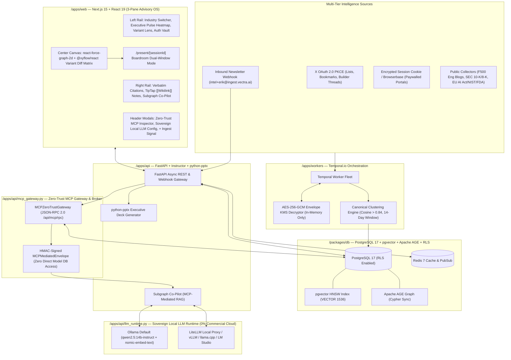
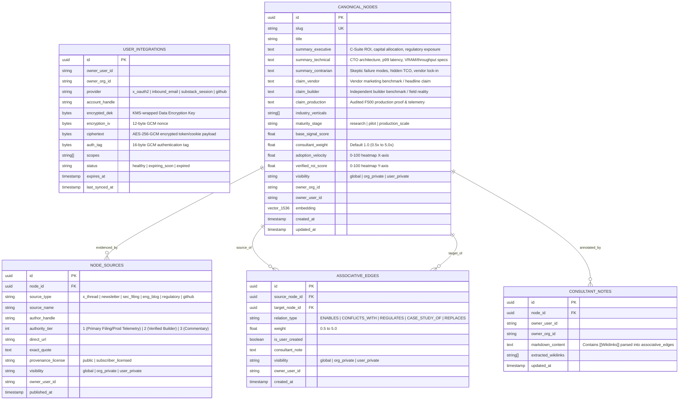

# ARCHITECTURE_AND_ERD — VECTRA: Enterprise AI Intelligence & Advisory OS

## 1. High-Level System Architecture



---

## 2. Database Entity-Relationship Diagram (ERD)



---

## 3. Multi-Tenant Row-Level Security (RLS) & Credential Vault

### 3.1 PostgreSQL 17 Row-Level Security Policies
Every query executed by `/apps/api` sets tenant session context variables (`SET LOCAL app.current_user_id = 'erik'; SET LOCAL app.current_org_id = 'vectra-advisory';`):
- **Global & Private Node Visibility Policy**:
  ```sql
  CREATE POLICY canonical_nodes_tenant_isolation ON canonical_nodes
    FOR SELECT USING (
      visibility = 'global'
      OR (visibility = 'org_private' AND owner_org_id = current_setting('app.current_org_id', true))
      OR (visibility = 'user_private' AND owner_user_id = current_setting('app.current_user_id', true))
    );
  ```
- **Source Provenance Isolation Policy**:
  Shared `global` canonical nodes can have both `global` (`public`) sources and `user_private` (`subscriber_licensed`) sources attached. The RLS policy on `node_sources` ensures Erik sees his private *Stratechery* / *Pragmatic Engineer* / private X Bookmark excerpts merged seamlessly onto global Canonical Nodes, while other tenants never see Erik's `user_private` rows.

### 3.2 AES-256-GCM Envelope Encryption Vault
1. **Master Key (KEK)**: Loaded in KMS abstraction (`VECTRA_KMS_MASTER_KEY`).
2. **Per-Integration Data Encryption Key (DEK)**: 32-byte random key generated per integration row, encrypted with the KEK.
3. **Token Ciphertext**: OAuth refresh tokens and session cookies are encrypted with the DEK using `AES-256-GCM` (12-byte IV + 16-byte authentication tag).
4. **Decryption Boundary**: Only Temporal worker activities decrypt tokens in-memory during scheduled scraping or OAuth token refresh. The API layer never returns raw tokens to the client.

---

## 4. Canonical Clustering & Composite Score Mathematics

For every Canonical Node $i$ with connected sources $S_i$ visible to the current tenant and edges $E_i$:

$$\text{Recency\_Decay}(s) = \exp\left(-\lambda \cdot \Delta t_{\text{days}}(s)\right), \quad \lambda = \frac{\ln(2)}{7}$$

$$\text{Authority\_Multiplier}(s) = \begin{cases} 3.0 & \text{if Tier 1 (Primary Filing / Production Telemetry)} \\ 2.0 & \text{if Tier 2 (Verified Principal Architect / Newsletter)} \\ 1.0 & \text{if Tier 3 (Market Commentary)} \end{cases}$$

$$\text{Graph\_Centrality}(i) = \sum_{e \in E_i} w_e \cdot \alpha_{\text{rel}}(e)$$

$$\text{Composite\_Score}(i) = \left( \sum_{s \in S_i} \left(\text{Authority\_Multiplier}(s) \times \text{Recency\_Decay}(s) \times 8.5\right) + \text{Graph\_Centrality}(i) \right) \times \text{Consultant\_Weight}_i$$
