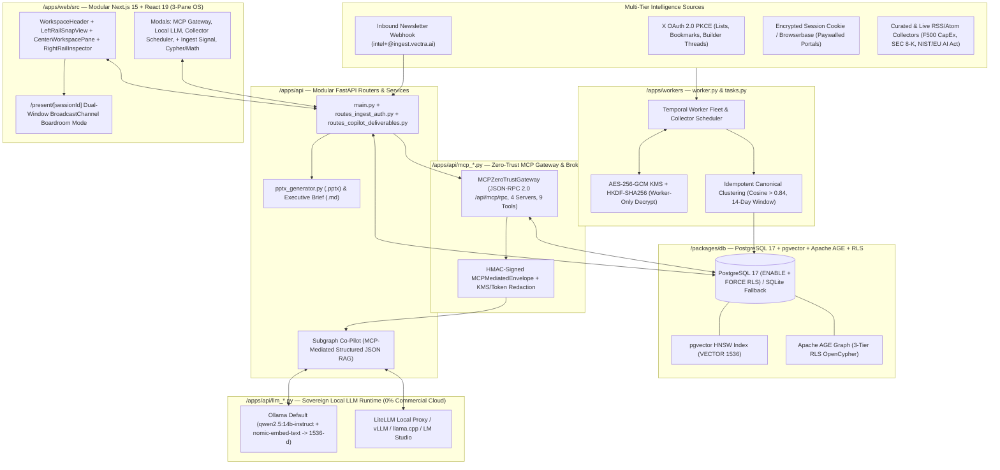
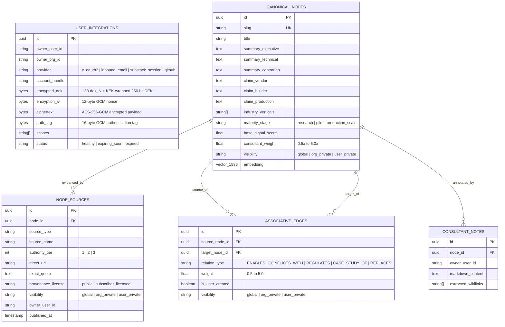

# ARCHITECTURE_AND_ERD — VECTRA: Enterprise AI Intelligence & Advisory OS

> See [`AGENTS.md`](./AGENTS.md) for the mandatory `350 + 20%` (`420` LOC) modularity standard and [`DEPLOYMENT_AND_REVIEW_ARCHITECTURE.md`](./DEPLOYMENT_AND_REVIEW_ARCHITECTURE.md) for the 6-Gate local pre-commit review pipeline.

## 1. High-Level System Architecture

---

## 2. Database Entity-Relationship Diagram (ERD)

Full DDL and RLS policies live in [`packages/db/sql/init_extensions_and_rls.sql`](./packages/db/sql/init_extensions_and_rls.sql) and ORM definitions in [`packages/db/vectra_db/models.py`](./packages/db/vectra_db/models.py).

---

## 3. Multi-Tenant Row-Level Security (RLS) & KMS Envelope Vault

1. **PostgreSQL 17 `ENABLE` + `FORCE ROW LEVEL SECURITY` ([`init_extensions_and_rls.sql`](./packages/db/sql/init_extensions_and_rls.sql))**:
   - Scoped per transaction via `app.current_user_id` and `app.current_org_id` in [`session.py`](./packages/db/vectra_db/session.py), mirrored by `rls_visibility_filter()` on SQLite fallback.
   - Allows `user_private` (`[Subscriber Licensed]`) sources to attach onto shared `global` Canonical Nodes without cross-tenant leakage.
2. **AES-256-GCM Envelope Vault & HKDF ([`vault.py`](./packages/db/vectra_db/vault.py) & [`security.py`](./packages/db/vectra_db/security.py))**:
   - Per-record 256-bit DEKs wrapped under `VECTRA_KMS_MASTER_KEY` + deterministic per-tenant `HKDF-SHA256` key derivation (`derive_tenant_kek_hkdf()`).
   - Decrypted **only** inside worker memory (`decrypt_in_worker_memory()`).

---

## 4. Canonical Clustering & Composite Score Mathematics ([`scoring.py`](./packages/db/vectra_db/scoring.py))

For each Canonical Node $i$ with visible sources $S_i$ and incident edges $E_i$:

$$\text{Recency\_Decay}(s) = \exp\left(-\lambda \cdot \Delta t_{\text{days}}(s)\right), \quad \lambda = \frac{\ln(2)}{10.0}$$

$$\text{Authority\_Multiplier}(s) = \begin{cases} 3.0 & \text{Tier 1 (Primary Filing / Production Telemetry / Regulatory)} \\ 2.1 & \text{Tier 2 (Verified Principal Builder / Paid Newsletter)} \\ 1.2 & \text{Tier 3 (Secondary Market Commentary)} \end{cases}$$

$$\text{Graph\_Centrality}(i) = \sum_{e \in E_i} w_e \cdot \alpha_{\text{rel}}(e), \quad \alpha_{\text{rel}} \in [3.5, 4.5]$$

$$\text{Composite\_Score}(i) = \operatorname{round}\!\left(\left(0.35 \cdot B_i + \sum_{s \in S_i} \text{Authority\_Multiplier}(s) \cdot \text{Recency\_Decay}(s) \cdot 9.5 + \text{Graph\_Centrality}(i)\right) \times \operatorname{clip}(W_i, 0.5, 5.0),\; 1\right)$$
