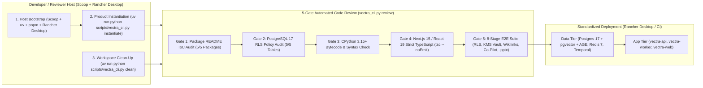

# DEPLOYMENT_AND_REVIEW_ARCHITECTURE — VECTRA

> [!IMPORTANT]
> **Objective**: Provide a deterministic, cross-platform workflow for engineering teams and AI agents to **review code**, **clean workspace state**, **instantiate the product**, and **deploy standardized containers** across Windows (Scoop + Rancher Desktop), macOS, and Linux using `uv` / `uvx` (latest standard CPython) and `pnpm`.

---

## Table of Contents
1. [Team Workflow & Deployment Pipeline Diagram](#1-team-workflow--deployment-pipeline-diagram)
2. [Standardized Lifecycle Commands (`scripts/vectra_cli.py`)](#2-standardized-lifecycle-commands-scriptsvectra_clipy)
3. [5-Gate Automated Code Review & Audit (`review`)](#3-5-gate-automated-code-review--audit-review)
4. [Workspace Clean-Up & State Reset (`clean`)](#4-workspace-clean-up--state-reset-clean)
5. [Zero-to-Running Product Instantiation (`instantiate`)](#5-zero-to-running-product-instantiation-instantiate)
6. [Standardized Container Deployment on Rancher Desktop (`deploy-up`)](#6-standardized-container-deployment-on-rancher-desktop-deploy-up)

---

## 1. Team Workflow & Deployment Pipeline Diagram



---

## 2. Standardized Lifecycle Commands (`scripts/vectra_cli.py`)

All team operations run through [`scripts/vectra_cli.py`](./scripts/vectra_cli.py) (or its aliases in [`package.json`](./package.json)):

| Operation | `uv` Command | `pnpm` Alias | Description |
| :--- | :--- | :--- | :--- |
| **Instantiate Product** | `uv run python scripts/vectra_cli.py instantiate` | `pnpm instantiate` | Copies `.env.example` $\to$ `.env`, provisions latest CPython `.venv`, installs dependencies, and runs all 5 review gates. |
| **Team Code Review** | `uv run python scripts/vectra_cli.py review` | `pnpm review` | Runs ToC README audit, RLS SQL policy check, Python compile check, TypeScript `tsc --noEmit`, and 14-stage E2E verification. |
| **Clean Workspace** | `uv run python scripts/vectra_cli.py clean` | `pnpm clean` | Purges `__pycache__`, `.turbo`, `.pytest_cache`, `.ruff_cache`, `.egg-info`, and temporary bundles (`--reset-db` also resets local SQLite). |
| **Start Data Infra** | `uv run python scripts/vectra_cli.py infra-up` | `pnpm infra:up` | Starts Postgres 17 (`pgvector` + `AGE`), Redis 7, and Temporal via Rancher Desktop (`nerdctl compose` or `docker compose`). |
| **Full Container Deploy** | `uv run python scripts/vectra_cli.py deploy-up` | `pnpm deploy:up` | Builds and launches the complete 7-container production stack (`docker-compose.yml` + `docker-compose.prod.yml`). |
| **Tear Down Deploy** | `uv run python scripts/vectra_cli.py deploy-down` | `pnpm deploy:down` | Stops and removes the full containerized stack. |

---

## 3. 5-Gate Local Pre-Commit Code Review & Audit (`review`)

GitHub Actions pipelines are intentionally disabled (`0% Cloud CI Dependency`). All code review and security verification gates run **100% locally before every commit** via `.git/hooks/pre-commit` and `uv run python scripts/vectra_cli.py review` (`pnpm review`):
1. **Gate 1 — Documentation & ToC Audit**: Verifies that root `README.md`, `packages/db/README.md`, `apps/api/README.md`, `apps/workers/README.md`, and `apps/web/README.md` exist and contain `## Table of Contents`.
2. **Gate 2 — Multi-Tenant RLS DDL Audit**: Verifies that `ALTER TABLE <tbl> ENABLE ROW LEVEL SECURITY;` (plus `FORCE ROW LEVEL SECURITY;`) is present for all 5 core tables in [`init_extensions_and_rls.sql`](./packages/db/sql/init_extensions_and_rls.sql).
3. **Gate 3 — Latest Standard CPython Bytecode Audit**: Compiles all Python modules across `packages/db`, `apps/api`, `apps/workers`, and `scripts` on the active `uv`-managed CPython (`3.15.2+`).
4. **Gate 4 — UI Component DOM Test-ID & Next.js 15 TypeScript Strict Gate**: Verifies all 9 interactive UI component DOM anchors and executes `tsc --noEmit` in `apps/web` to ensure zero type regressions across the 3-Pane UI and Boardroom Mode.
5. **Gate 5 — 14-Stage End-to-End Functional, Local LLM & Zero-Trust MCP Suite**: Runs [`verify_vectra_stack.py`](./packages/db/verify_vectra_stack.py) validating cross-tenant RLS blocking, `AES-256-GCM` KMS envelope encryption, dynamic `Composite_Score` weighting, `[[Wikilink]]` edge sync, inbound newsletter clustering, Subgraph Co-Pilot RAG, `python-pptx` deck generation, F500/SEC/NIST collectors, Sovereign Local LLM (`ollama` default + zero-commercial guardrail), and Zero-Trust MCP Gateway mediation.

---

## 4. Workspace Clean-Up & State Reset (`clean`)

To sanitize the repository before code review, archiving, or fresh testing:
```powershell
# Remove transient caches, bytecode, and build artifacts
uv run python scripts/vectra_cli.py clean

# Optional: Also wipe and re-seed the local SQLite fallback database
uv run python scripts/vectra_cli.py clean --reset-db
uv run python scripts/vectra_cli.py verify
```

---

## 5. Zero-to-Running Product Instantiation (`instantiate` in `D:\projects\vectra`)

The canonical Windows host directory for VECTRA is **`D:\projects\vectra`**. A developer or reviewer on Windows (with Scoop + Rancher Desktop) can instantiate the entire verified workspace in one command:

```powershell
# Clone from GitHub directly into D:\projects\vectra
New-Item -ItemType Directory -Force -Path D:\projects | Out-Null
git clone https://github.com/lithix-src/vectra.git D:\projects\vectra
Set-Location D:\projects\vectra

# Run zero-to-verified product instantiation (CPython 3.15.2+, pnpm, 5-gate review, 14/14 E2E suite)
uv run python scripts/vectra_cli.py instantiate
```

Then start the interactive services from `D:\projects\vectra`:
```powershell
# Single-Terminal Concurrent Launch (FastAPI :8000 + Next.js 15 :3000)
Set-Location D:\projects\vectra
uv run python scripts/vectra_cli.py dev
```

---

## 6. Standardized Container Deployment on Rancher Desktop (`deploy-up`)

For staging, team review servers, or full containerized deployment using **Rancher Desktop** (`nerdctl compose` or `dockerd/moby`):

- **Backend & Worker Image ([`apps/api/Dockerfile`](./apps/api/Dockerfile))**: Built on `ghcr.io/astral-sh/uv:debian-slim`, automatically installing the latest standard CPython via `uv python install` and provisioning `/app/.venv`.
- **Frontend Image ([`apps/web/Dockerfile`](./apps/web/Dockerfile))**: Multi-stage `node:24-alpine` + Corepack `pnpm` production build.
- **Compose Overlay ([`docker-compose.prod.yml`](./docker-compose.prod.yml))**: Joins `vectra-api`, `vectra-worker`, and `vectra-web` with `postgres` (`apache/age:release_PG17_1.5.0`), `redis`, `temporal`, and `temporal-ui`:

```powershell
# Build and launch all 7 containers via Rancher Desktop
uv run python scripts/vectra_cli.py deploy-up

# Tear down the containerized deployment
uv run python scripts/vectra_cli.py deploy-down
```
