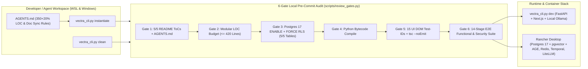

# DEPLOYMENT_AND_REVIEW_ARCHITECTURE — VECTRA

> [!IMPORTANT]
> **Mandatory Modularity & Review Standard ([`AGENTS.md`](./AGENTS.md))**: Every authored file in VECTRA targets **<= 350 lines** with a hard pre-commit cap of **`420` lines (`350 + 20%`)** enforced by [`scripts/review_gates.py`](./scripts/review_gates.py). All documentation is kept synchronized in lockstep with code changes via relative Markdown links.

---

## Table of Contents
1. [Team Workflow & 6-Gate Pipeline Diagram](#1-team-workflow--6-gate-pipeline-diagram)
2. [Standardized Lifecycle Commands (`scripts/vectra_cli.py`)](#2-standardized-lifecycle-commands-scriptsvectra_clipy)
3. [6-Gate Local Pre-Commit Code Review & Audit (`review`)](#3-6-gate-local-pre-commit-code-review--audit-review)
4. [Workspace Clean-Up & State Reset (`clean`)](#4-workspace-clean-up--state-reset-clean)
5. [Zero-to-Running Instantiation & Concurrent Dev (`instantiate` / `dev`)](#5-zero-to-running-instantiation--concurrent-dev-instantiate--dev)
6. [Standardized Container Deployment (`infra-up` / `deploy-up`)](#6-standardized-container-deployment-infra-up--deploy-up)

---

## 1. Team Workflow & 6-Gate Pipeline Diagram



---

## 2. Standardized Lifecycle Commands (`scripts/vectra_cli.py`)

All team operations run through [`scripts/vectra_cli.py`](./scripts/vectra_cli.py) (backed by [`scripts/review_gates.py`](./scripts/review_gates.py) and aliased in [`package.json`](./package.json)):

| Operation | `uv` Command | `pnpm` Alias | Description |
| :--- | :--- | :--- | :--- |
| **Instantiate Product** | `uv run python scripts/vectra_cli.py instantiate` | `pnpm instantiate` | Creates `.env`, provisions `.venv` & `.git/hooks/pre-commit`, installs `node_modules`, and runs all 6 review gates. |
| **Team Code Review** | `uv run python scripts/vectra_cli.py review` | `pnpm review` | Runs all 6 architecture, `350+20%` LOC modularity, RLS, TypeScript, and 14-stage E2E gates. |
| **Concurrent Dev** | `uv run python scripts/vectra_cli.py dev` | — | Launches FastAPI (`:8000`) and Next.js 15 (`:3000`, auto-selecting free ports if occupied). |
| **Clean Workspace** | `uv run python scripts/vectra_cli.py clean` | `pnpm clean` | Purges `__pycache__`, `.turbo`, `.pytest_cache`, `.ruff_cache`, `.egg-info` (`--reset-db` resets SQLite). |
| **Start Data Infra** | `uv run python scripts/vectra_cli.py infra-up` | `pnpm infra:up` | Starts Postgres 17 (`pgvector` + `AGE`), Redis 7, Temporal, Ollama & LiteLLM via [`docker-compose.yml`](./docker-compose.yml). |
| **Full Container Deploy** | `uv run python scripts/vectra_cli.py deploy-up` | `pnpm deploy:up` | Builds and launches the containerized stack ([`docker-compose.yml`](./docker-compose.yml) + [`docker-compose.prod.yml`](./docker-compose.prod.yml)). |
| **Tear Down Deploy** | `uv run python scripts/vectra_cli.py deploy-down` | `pnpm deploy:down` | Stops and removes the containerized stack. |

---

## 3. 6-Gate Local Pre-Commit Code Review & Audit (`review`)

GitHub Actions is intentionally disabled (`enabled=false` on GitHub via `uv run python scripts/vectra_cli.py disable-gh-actions`, `.github/workflows/` blocked). Every commit is gated locally by `.git/hooks/pre-commit` executing `uv run python scripts/vectra_cli.py review`:
1. **Gate 1 — Documentation, ToC, Dev Rules & Zero GitHub Actions Audit**: Verifies [`README.md`](./README.md), [`packages/db/README.md`](./packages/db/README.md), [`apps/api/README.md`](./apps/api/README.md), [`apps/workers/README.md`](./apps/workers/README.md), and [`apps/web/README.md`](./apps/web/README.md) contain `## Table of Contents`, root [`AGENTS.md`](./AGENTS.md) is present, and `.github/workflows/` contains zero workflow files.
2. **Gate 2 — Modular File-Size Budget (`<= 350 + 20% = 420` Lines)**: Audits all authored files across the monorepo and fails if any file exceeds `420` lines, enforcing clean decomposition via Python/TS imports and Markdown links.
3. **Gate 3 — Multi-Tenant RLS DDL Audit**: Verifies both `ENABLE ROW LEVEL SECURITY;` and `FORCE ROW LEVEL SECURITY;` across all 5 core tables in [`init_extensions_and_rls.sql`](./packages/db/sql/init_extensions_and_rls.sql).
4. **Gate 4 — Python Syntax & Bytecode Audit**: Compiles all modules across `packages/db`, `apps/api`, `apps/workers`, and `scripts`.
5. **Gate 5 — UI DOM Test-ID Contract & Strict TypeScript (`tsc --noEmit`)**: Scans modular React components under `apps/web/src/**/*.tsx` for all 15 required UI DOM anchors (including `#target-context-expression-input`, `#context-match-rationale-card`, `#right-tab-associations`, `#data-association-navigator`, and `#collector-scheduler-modal`) and runs `tsc --noEmit`.
6. **Gate 6 — 14-Stage End-to-End Verification Suite**: Executes [`verify_vectra_stack.py`](./packages/db/verify_vectra_stack.py) validating RLS isolation, `AES-256-GCM` KMS + `HKDF-SHA256`, dynamic `Composite_Score` math, `[[Wikilink]]` edge sync, idempotent webhook/collector clustering, sanitized 3-tier RLS Cypher, `.pptx`/`.md` exports, Sovereign Local LLM (`ollama` + zero-commercial guardrail), and Zero-Trust MCP Gateway mediation.

---

## 4. Workspace Clean-Up & State Reset (`clean`)

```bash
uv run python scripts/vectra_cli.py clean --reset-db
uv run python scripts/vectra_cli.py review
```

---

## 5. Zero-to-Running Instantiation & Concurrent Dev (`instantiate` / `dev`)

```bash
uv run python scripts/vectra_cli.py instantiate
uv run python scripts/vectra_cli.py dev
```

---

## 6. Standardized Container Deployment (`infra-up` / `deploy-up`)

- **Backend & Worker Image**: [`apps/api/Dockerfile`](./apps/api/Dockerfile) (`ghcr.io/astral-sh/uv:debian-slim`).
- **Frontend Image**: [`apps/web/Dockerfile`](./apps/web/Dockerfile) (`node:24-alpine` + `pnpm`).
- **Compose Definitions**: [`docker-compose.yml`](./docker-compose.yml) and [`docker-compose.prod.yml`](./docker-compose.prod.yml).
