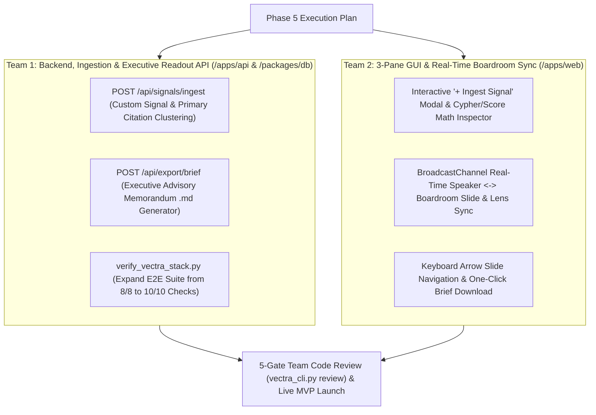

# IMPLEMENTATION_PLAN & STATE — VECTRA: Enterprise AI Intelligence & Advisory OS

> [!IMPORTANT]
> **Current Project State**: **PHASES 1–6 COMPLETE (`14/14` E2E Checks & `5/5` Review Gates Verified on `CPython 3.15.2`) — LIVE MVP RUNNING**
> **Toolchain & Management Standard**:
> - **Canonical Windows Target Directory**: **`D:\projects\vectra`** (Cloud VM staging mirror: `/home/antigravity/lithix-src/vectra`).
> - **Windows Host**: **Scoop** (`main/git`, `main/gh`, `main/uv`, `main/nodejs-lts`, `main/pnpm`, `main/ollama`, `extras/rancher-desktop`).
> - **Sovereign Local LLM & Embeddings Runtime**: **`ollama` default** (`qwen2.5:14b-instruct` + `nomic-embed-text`), plus `litellm_proxy` ([`litellm_config.yaml`](./litellm_config.yaml)), `vllm`, `llamacpp`, and `lmstudio`. Strict **`VECTRA_BLOCK_COMMERCIAL_LLMS=true`** guardrail blocks all commercial cloud APIs.
> - **Zero-Trust MCP Mediation**: All LLM context and tool access is strictly brokered via [`apps/api/mcp_gateway.py`](./apps/api/mcp_gateway.py) (`MCPZeroTrustGateway`, JSON-RPC 2.0 `/api/mcp/rpc`, HMAC-signed `MCPMediatedEnvelope` — zero direct model access to DB/KMS/services).
> - **Container Runtime**: **Rancher Desktop** (`nerdctl compose` or `dockerd/moby` via `uv run python scripts/vectra_cli.py infra-up` / `deploy-up`).
> - **Python Management**: **`uv` & `uvx`** tracking the **latest standard CPython release** (`CPython 3.15.2+`). Zero `Makefile` dependencies.
> - **Documentation Standard**: Every package maintains a thorough `README.md` with a complete **Table of Contents (ToC)**.

---

## Phase 5: v1.1 Enterprise Delivery Workstreams (Completed & Verified `10/10`)

### Workstream 1 — Backend, Custom Signal Ingestion & Executive Memo API (`Team 1`)
- **File Ownership**: `apps/api/main.py`, `packages/db/verify_vectra_stack.py`, `apps/api/README.md`
- **Deliverables**:
  1. `POST /api/signals/ingest`: Allows Erik to submit any live primary URL, verbatim pull-quote, source type, authority tier (`1–3`), provenance (`public` | `subscriber_licensed`), visibility (`global` | `org_private` | `user_private`), and industry verticals—automatically embedding (`1536-d`) and clustering (`cosine > 0.84`) onto active 14-day Canonical Nodes or creating a new Canonical Node.
  2. `POST /api/export/brief`: Generates a structured, client-ready **Executive Advisory Memorandum (`.md`)** containing C-Suite Thesis, CTO Architecture Spec, Contrarian Risk Register, Verbatim Evidence Table (`[Public]` vs `[Subscriber Licensed]`), and 90-Day Action Plan.
  3. Expand `packages/db/verify_vectra_stack.py` to **10/10 end-to-end checks**.

### Workstream 2 — 3-Pane GUI Modals & Real-Time Boardroom Synchronization (`Team 2`)
- **File Ownership**: `apps/web/src/app/page.tsx`, `apps/web/src/app/present/[sessionId]/page.tsx`, `apps/web/README.md`
- **Deliverables**:
  1. **Interactive `+ Ingest Signal` Modal**: Form in the main workspace to ingest custom primary evidence or create new Canonical Nodes live on the graph.
  2. **Apache AGE OpenCypher & Score Math Modal**: Interactive drawer displaying the live `cypher('vectra_knowledge_graph', ...)` query and exact mathematical components (`source_authority_component`, `graph_centrality_component`, `consultant_weight`, `composite_score`).
  3. **Dual-Window `BroadcastChannel` Sync & Keyboard Navigation in Boardroom Mode**: Synchronizes slide changes and Variant Lens switches in real time between Erik's private Speaker Console (`?role=presenter`) and the main Boardroom Projection window, plus `ArrowLeft` / `ArrowRight` keyboard navigation.
